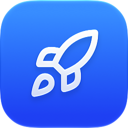
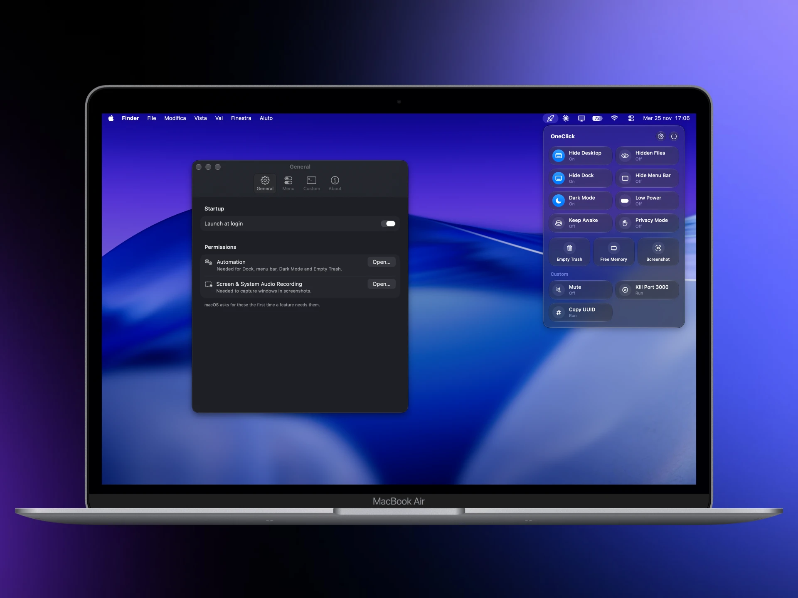

<div align="center" markdown="1">



# OneClick

**Handy macOS settings and actions, one click away in your menu bar.**

[](https://github.com/mik3sw/OneClick/releases/latest)
[](https://github.com/mik3sw/OneClick/releases)
[](#requirements)
[](https://www.swift.org)
[](https://developer.apple.com/xcode/swiftui/)
[](LICENSE)
[](https://github.com/mik3sw/OneClick/stargazers)

[**Download OneClick**](https://github.com/mik3sw/OneClick/releases/latest) · [Features](#features) · [Custom items](#custom-items) · [Build from source](#build-from-source)



</div>

## Highlights

- **Control Center–style panel** with Liquid Glass tiles that show the real state of your Mac
- **11 built-in toggles and actions**: hide the desktop, Dock or menu bar, Dark Mode, Low Power Mode, Keep Awake and more
- **Your own toggles and buttons**: run any shell command or script, with a picker for every SF Symbol
- **Lightweight and native**: about 4 MB, universal (Apple Silicon and Intel), no third-party dependencies
- **Free and open source** under the MIT License

## Requirements

- macOS 26 Tahoe or later
- Apple Silicon or Intel Mac

## Installation

1. Download `OneClick-3.0.zip` from the [latest release](https://github.com/mik3sw/OneClick/releases/latest).
2. Unzip it and move **OneClick.app** to your Applications folder.
3. Open it. The rocket icon appears in the menu bar.

> [!NOTE]
> OneClick is a hobby project and isn't notarized by Apple, so the first launch is blocked.
> Open **System Settings › Privacy & Security**, scroll down and click **Open Anyway** next to OneClick.
> Or remove the quarantine flag from Terminal:
>
> ```bash
> xattr -dr com.apple.quarantine /Applications/OneClick.app
> ```

To start OneClick automatically, turn on **Launch at login** in Settings › General.

## Features

### Toggles

| Toggle | What it does |
|---|---|
| **Hide Desktop** | Hides files and folders on the desktop (`com.apple.finder CreateDesktop`, restarts Finder) |
| **Hidden Files** | Shows hidden files in Finder (`com.apple.finder AppleShowAllFiles`, restarts Finder) |
| **Hide Dock** | Turns Dock auto-hide on or off |
| **Hide Menu Bar** | Turns menu bar auto-hide on or off |
| **Dark Mode** | Switches between Light and Dark appearance |
| **Low Power** | Turns Low Power Mode on or off (`pmset`, asks for an administrator password) |
| **Keep Awake** | Keeps the Mac and display awake, like `caffeinate`, until you turn it off or quit |
| **Privacy Mode** | Hides desktop icons, Dock and menu bar at once, e.g. before sharing your screen |

### Actions

| Action | What it does |
|---|---|
| **Empty Trash** | Empties the Trash through Finder. Click twice to confirm. |
| **Free Memory** | Runs `purge` (asks for an administrator password) |
| **Screenshot** | Captures the screen after 3 seconds into your screenshots folder |

You can show, hide and reorder every item in **Settings › Menu**.

## Custom items


In **Settings › Custom** you can add as many toggles and buttons as you like, each with your own commands and any SF Symbol, chosen from a searchable picker with every symbol in macOS.

- **Toggle**: one command for on and one for off. Add an optional *status check*: the toggle shows as on when that command exits with code `0`. Without one, OneClick remembers the last state.
- **Button**: runs a single command and shows a checkmark when it succeeds.

Commands run in your login shell (`zsh -l`), so tools installed with Homebrew are found. If a command fails, its error message appears in the panel.

### Examples

OneClick starts with three examples you can edit or delete:

| Item | Type | Command |
|---|---|---|
| **Mute** | Toggle | `osascript -e 'set volume output muted true'` / `false`<br>Status: `osascript -e 'output muted of (get volume settings)' \| grep -q true` |
| **Kill Port 3000** | Button | Stops whatever is listening on port 3000 (`lsof -ti tcp:3000 -sTCP:LISTEN`, then `kill`) |
| **Copy UUID** | Button | `uuidgen \| tr -d '\n' \| pbcopy` |

More ideas:

| Item | Type | Command |
|---|---|---|
| **Docker** | Toggle | On: `open -a Docker` · Off: `osascript -e 'quit app "Docker"'` · Status: `docker info >/dev/null 2>&1` |
| **Wi-Fi** | Toggle | On/Off: `networksetup -setairportpower en0 on` / `off` · Status: `networksetup -getairportpower en0 \| grep -q On` |
| **Flush DNS** | Button | `osascript -e 'do shell script "dscacheutil -flushcache; killall -HUP mDNSResponder" with administrator privileges'` |
| **Clean DerivedData** | Button | `rm -rf ~/Library/Developer/Xcode/DerivedData/*` |

### Running scripts

Any script works, in any language you have installed:

```bash
python3 ~/scripts/backup.py
node ~/scripts/deploy.js
~/projects/tool/.venv/bin/python ~/projects/tool/run.py
```

Exit with a non-zero status and write to stderr to show an error in the panel (`sys.exit(1)` in Python).

## Permissions

The first time you use some features, macOS asks for permission:

| Permission | Needed for |
|---|---|
| **Automation** (System Events, Finder) | Hide Dock, Hide Menu Bar, Dark Mode, Empty Trash |
| **Screen & System Audio Recording** | Screenshot (without it, only the wallpaper is captured) |

Settings › General has shortcuts to both panes in System Settings.

## Upgrading from 2.x

OneClick 3.0 is a complete rewrite. Your choice of visible items and your custom toggle are imported automatically. The background image themes are gone: the panel now uses the system's Liquid Glass material and follows Light and Dark Mode.

## Build from source

Requires Xcode 26 or later. There are no dependencies to install.

```bash
git clone https://github.com/mik3sw/OneClick.git
cd OneClick
open OneClick.xcodeproj
```

Then run the `OneClick` scheme. The code is organized in three folders:

| Folder | Contents |
|---|---|
| `OneClick/Model` | Built-in features, custom items, preferences, SF Symbols catalog |
| `OneClick/Services` | Running commands, reading system state, Keep Awake |
| `OneClick/Views` | Menu bar panel and Settings window |

## Contributing

Bug reports and ideas are welcome in [Issues](https://github.com/mik3sw/OneClick/issues). Pull requests are welcome too.

## Reviews

- [MacUpdate](https://www.macupdate.com/app/mac/63828/oneclick)
- [Softpedia](https://mac.softpedia.com/get/System-Utilities/mik3sw-OneClick.shtml)

## Credits

- App icon based on the [Lucide](https://lucide.dev/icons/rocket) rocket (ISC License)

## License

OneClick is released under the [MIT License](LICENSE).
