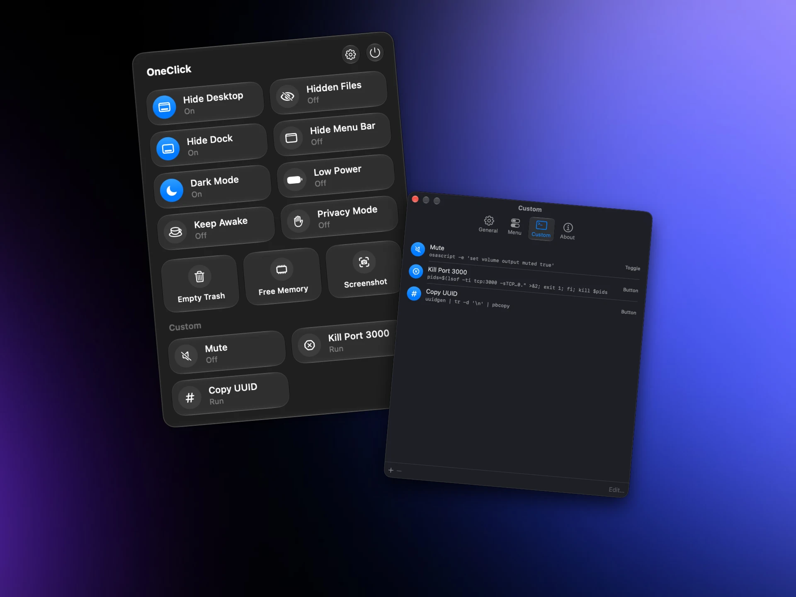

# OneClick

  

OneClick gives you quick access to handy macOS settings and actions from the menu bar.

* **macOS 26 Tahoe or later** (Apple Silicon and Intel)
* Built with SwiftUI and Liquid Glass
* Free and open source

## Downloads

* [Releases](https://github.com/mik3sw/OneClick/releases)

> This is a hobbyist app. Version 3.0 is a full rewrite of the 2.x series; 2.x is no longer maintained.

## Features

### Toggles

| Toggle | What it does |
|---|---|
| Hide Desktop | Hides files and folders on the desktop (`com.apple.finder CreateDesktop`, restarts Finder) |
| Hidden Files | Shows hidden files in Finder (`com.apple.finder AppleShowAllFiles`, restarts Finder) |
| Hide Dock | Turns Dock auto-hide on or off (System Events) |
| Hide Menu Bar | Turns menu bar auto-hide on or off (System Events) |
| Dark Mode | Switches between Light and Dark appearance (System Events) |
| Low Power | Turns Low Power Mode on or off (`pmset`, asks for an administrator password) |
| Keep Awake | Keeps the Mac and display awake, like `caffeinate` (released when you quit OneClick) |
| Privacy Mode | Hides desktop icons, Dock and menu bar at once |

### Actions

| Action | What it does |
|---|---|
| Empty Trash | Empties the Trash through Finder (click twice to confirm) |
| Free Memory | Runs `purge` (asks for an administrator password) |
| Screenshot | Captures the screen after 3 seconds into your screenshots folder |

### Custom items

In **Settings › Custom** you can add as many toggles and buttons as you like, each with your own shell commands and any SF Symbol, chosen from a searchable picker with every symbol in macOS:

* **Toggle**: one command for on and one for off. You can also add a *status check* command: the toggle shows as on when that command exits with code `0`. Without one, OneClick remembers the last state.
* **Button**: runs a single command.

Commands run in your login shell (`zsh -l`), so tools installed with Homebrew are found.

OneClick starts with three examples you can edit or delete:

| Item | Type | Command |
|---|---|---|
| Mute | Toggle | `osascript -e 'set volume output muted true'` / `false`, status from `output muted of (get volume settings)` |
| Kill Port 3000 | Button | Stops whatever is listening on port 3000 (`lsof -ti tcp:3000 -sTCP:LISTEN`, then `kill`) |
| Copy UUID | Button | `uuidgen \| tr -d '\n' \| pbcopy` |

### Settings

* **General**: launch at login, and shortcuts to the macOS permissions OneClick may need
* **Menu**: show, hide and reorder the built-in items
* **Custom**: manage custom items

## Permissions

The first time you use some features, macOS asks for permission:

* **Automation** (System Events, Finder): Hide Dock, Hide Menu Bar, Dark Mode, Empty Trash
* **Screen & System Audio Recording**: Screenshot (without it, only the wallpaper is captured)

You can review them in System Settings › Privacy & Security.

## Building

Open `OneClick.xcodeproj` in Xcode 26 or later and run the `OneClick` scheme. There are no third-party dependencies.

## Reviews

* [MacUpdate](https://www.macupdate.com/app/mac/63828/oneclick)
* [Softpedia](https://mac.softpedia.com/get/System-Utilities/mik3sw-OneClick.shtml)

## Credits

* App icon based on [Lucide](https://lucide.dev/icons/rocket) (ISC License)
